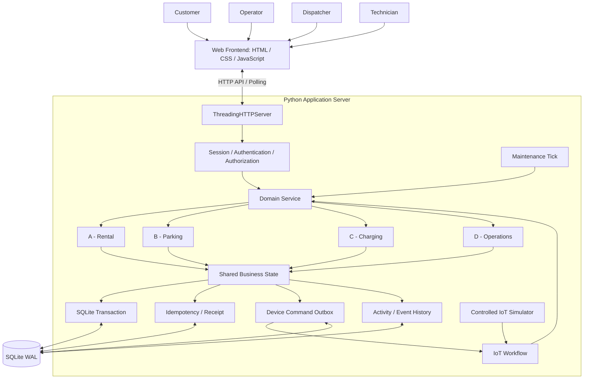
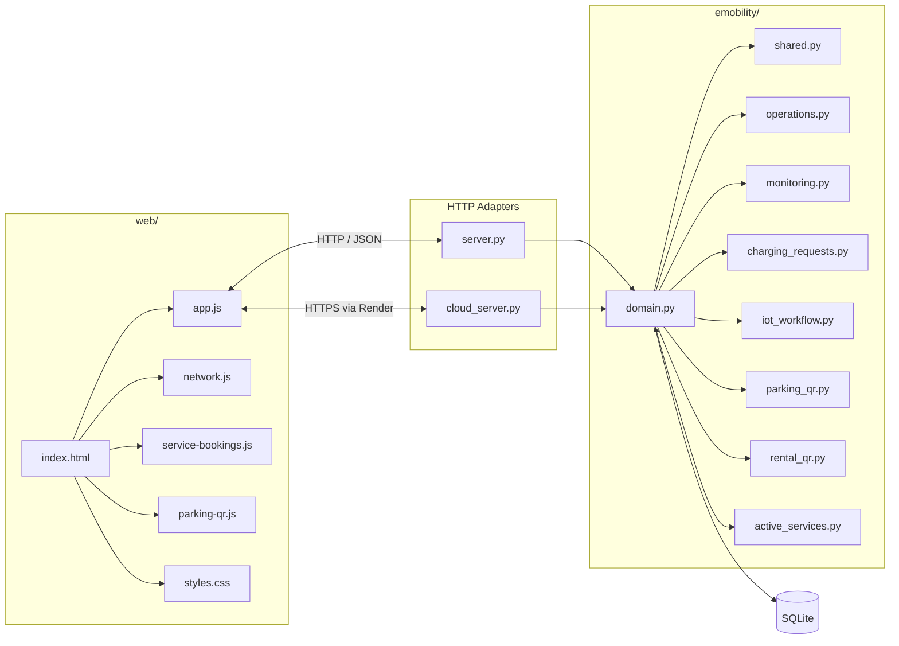
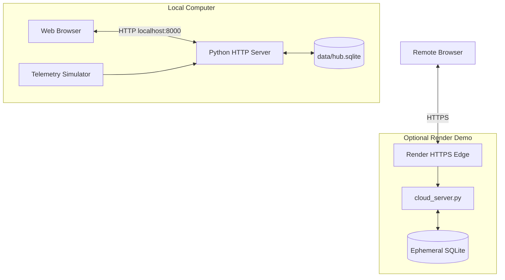
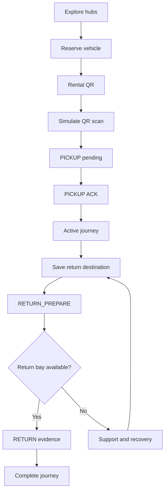
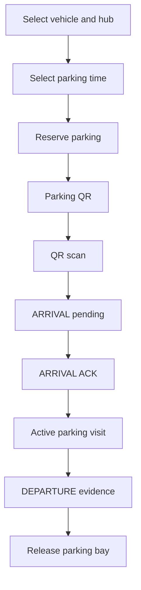
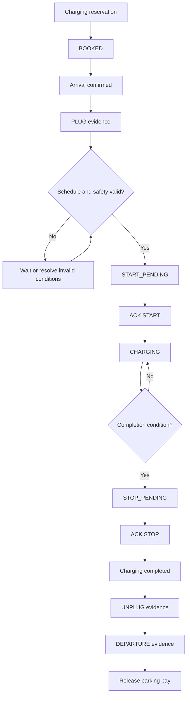
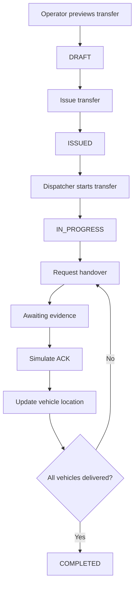
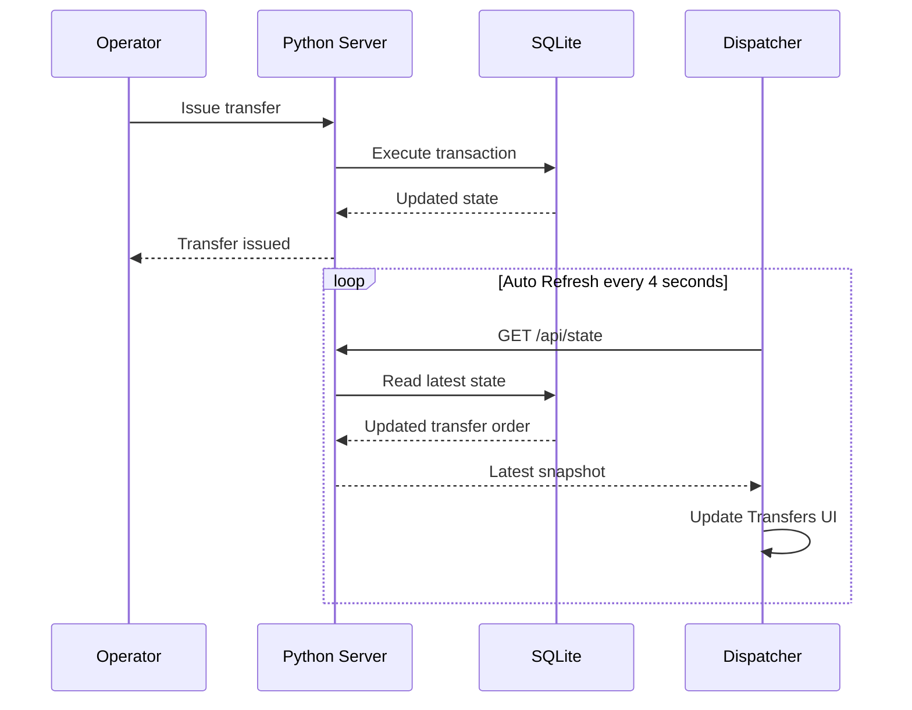
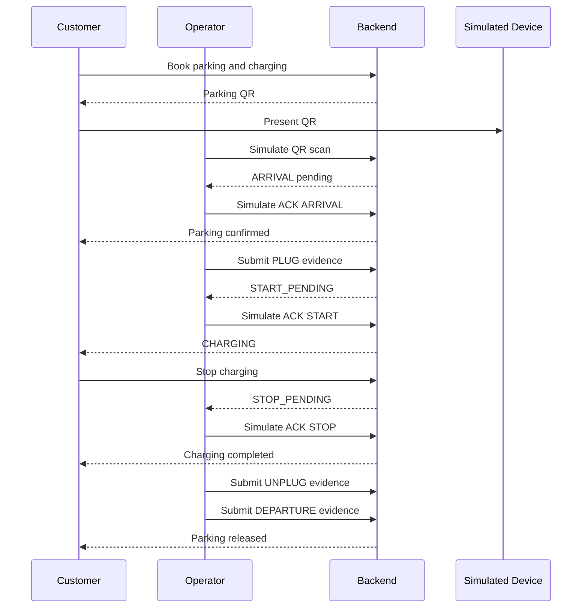

# Smart E-Mobility Hub

> Bài tập lớn môn Công nghệ phần mềm — Hệ thống quản lý và điều phối phương tiện điện trong mạng lưới Mobility Hub tại khu vực Đại học Quốc gia TP.HCM.

## 1. Giới thiệu dự án

Smart E-Mobility Hub là ứng dụng web tích hợp các dịch vụ thuê xe điện, đặt chỗ đỗ, sạc điện và điều phối vận hành trong một hệ thống thống nhất.

Dự án giải quyết các vấn đề về quản lý tài nguyên phân tán, xung đột đặt trước, lập lịch sử dụng cổng sạc, đồng bộ dữ liệu giữa các phân hệ và xác minh trạng thái vật lý của phương tiện, ô đỗ và thiết bị sạc.

Hệ thống được xây dựng dưới dạng Minimum Viable Product (MVP), phục vụ mục đích học tập, kiểm thử và trình diễn các nghiệp vụ tích hợp trong môn Công nghệ phần mềm.

### 1.1. Các phân hệ nghiệp vụ

| Phân hệ | Tên chức năng | Phạm vi nghiệp vụ |
|---|---|---|
| Module A | Rental Management | Thuê xe, giữ xe, nhận xe, trả xe và hỗ trợ hành trình |
| Module B | Parking Management | Đăng ký phương tiện cá nhân, đặt chỗ đỗ, vào bãi và rời bãi |
| Module C | Charging Management | Đăng ký sạc, lập lịch sạc, phân bổ công suất và quản lý phiên sạc |
| Module D | Operations Management | Điều chuyển phương tiện, bảo trì, hỗ trợ, dự báo nhu cầu và giám sát IoT |

Bốn phân hệ sử dụng chung cơ sở dữ liệu, tài khoản, giao dịch, trạng thái tài nguyên và nhật ký hoạt động.

Một thay đổi trong phân hệ này có thể ảnh hưởng trực tiếp đến các phân hệ khác. Ví dụ, việc điều chuyển phương tiện sang Hub mới đồng thời ảnh hưởng đến khả năng cho thuê, sức chứa của Hub nguồn và Hub đích, cũng như khả năng lập lịch sạc.

### 1.2. Mục tiêu

- Tập trung quản lý phương tiện điện, ô đỗ và cổng sạc.
- Hỗ trợ người dùng tra cứu và đăng ký dịch vụ thuận tiện.
- Ngăn ngừa xung đột khi cấp phát tài nguyên.
- Bảo đảm tính nhất quán giữa các phân hệ.
- Xác minh các thao tác vật lý thông qua QR, physical evidence và ACK.
- Đồng bộ trạng thái giữa nhiều tài khoản.
- Hỗ trợ điều chuyển phương tiện và bảo trì thiết bị.
- Giám sát telemetry và mô phỏng nhu cầu sử dụng tài nguyên.
- Bảo toàn dữ liệu khi khởi động lại ứng dụng.
- Hỗ trợ truy vết giao dịch, kiểm thử và xử lý các tình huống ngoại lệ.

### 1.3. Phạm vi dữ liệu mô phỏng

Dữ liệu khởi tạo của hệ thống gồm ba Mobility Hub:

| Hub ID | Tên Hub | Số ô đỗ | Số cổng sạc | Ngân sách công suất |
|---|---|---:|---:|---:|
| H1 | Metro Gateway | 10 | 2 | 7.4 kW |
| H2 | University Campus | 10 | 2 | 7.4 kW |
| H3 | Dormitory | 10 | 2 | 7.4 kW |
| **Tổng cộng** | | **30** | **6** | **22.2 kW** |

Mỗi Hub có hai ô đỗ được trang bị cổng sạc TYPE2, công suất định mức 3.7 kW cho mỗi cổng.

Các phương tiện được khởi tạo trong bộ dữ liệu mẫu:

| Vehicle ID | Loại phương tiện | Chủ sở hữu | Hub ban đầu | Ô đỗ ban đầu | SOC ban đầu |
|---|---|---|---|---|---:|
| V1 | Shared | Đội xe dùng chung | H1 | H1-S3 | 75% |
| V2 | Shared | Đội xe dùng chung | H2 | H2-S3 | 45% |
| V3 | Shared | Đội xe dùng chung | H1 | H1-S1 | 68% |
| P1 | Personal | Alice | Chưa xác định | Chưa xác định | 30% |
| P2 | Personal | Bob | Chưa xác định | Chưa xác định | 40% |

Dung lượng pin khởi tạo của mỗi phương tiện là 2.0 kWh.

Các giá trị trên chỉ áp dụng cho database mới được khởi tạo. Trạng thái thực tế có thể thay đổi sau khi thực hiện các nghiệp vụ thuê xe, đặt chỗ, sạc, điều chuyển và bảo trì.

## 2. Công nghệ sử dụng

| Thành phần | Công nghệ |
|---|---|
| Frontend | HTML5, CSS3, Vanilla JavaScript |
| Backend | Python 3.10+ |
| HTTP Server | Python ThreadingHTTPServer |
| Database | SQLite |
| Database Journal Mode | Write-Ahead Logging (WAL) |
| Giao tiếp | HTTP API, JSON |
| Xác thực | Session-based Authentication |
| Phân quyền | Role-based Authorization |
| Xử lý giao dịch | SQLite Transaction |
| Chống xử lý trùng | Intent ID và Receipt |
| Đồng bộ frontend | Periodic Polling |
| QR Generation | qrcode 8.2 |
| IoT Integration | Controlled IoT Simulator |
| Python Testing | unittest |
| Browser Testing | Playwright, Google Chrome |
| QR Image Testing | Pillow, zxing-cpp |
| Thiết kế hệ thống | Mermaid |
| Quản lý mã nguồn | Git, GitHub |
| Cloud Deployment | Render configuration |
| Kiến trúc | Modular Monolith |

Ứng dụng chính không yêu cầu Node.js hoặc npm để khởi động.

Node.js chỉ cần thiết nếu muốn sử dụng công cụ kiểm tra cú pháp JavaScript trong quá trình phát triển.

## 3. Cấu trúc repository

```text
CNPM_BTL/
│
├── emobility/
│   ├── __init__.py
│   ├── active_services.py
│   ├── charging_requests.py
│   ├── cloud_server.py
│   ├── domain.py
│   ├── iot_workflow.py
│   ├── monitoring.py
│   ├── operations.py
│   ├── parking_qr.py
│   ├── rental_qr.py
│   ├── server.py
│   ├── shared.py
│   ├── telemetry_simulator.py
│   └── samples/
│       └── connected_vehicles_dataset.json
│
├── web/
│   ├── app.js
│   ├── index.html
│   ├── network.js
│   ├── parking-qr.js
│   ├── service-bookings.js
│   └── styles.css
│
├── tests/
│   ├── artifacts/
│   │   ├── charging_qr_mobile.png
│   │   ├── parking_qr_desktop.png
│   │   ├── parking_qr_mobile.png
│   │   └── rental_qr_mobile.png
│   │
│   ├── test_active_service_counter.py
│   ├── test_adversarial.py
│   ├── test_charging_requests.py
│   ├── test_http_integration.py
│   ├── test_iot_workflow.py
│   ├── test_monitoring.py
│   ├── test_operations.py
│   ├── test_parking_qr.py
│   ├── test_rental_qr.py
│   │
│   ├── ui_button_audit.py
│   ├── ui_charging_reservations.py
│   ├── ui_iot_workflow.py
│   │
│   ├── ui_audit_results.json
│   ├── charging_ui_results.json
│   └── iot_ui_results.json
│
├── docs/
│   ├── 01_requirements/
│   │   ├── 00_course_project_brief.pdf
│   │   ├── 00_course_project_brief.txt
│   │   ├── 01_assignment_1_submitted.pdf
│   │   ├── 01_assignment_1_submitted.txt
│   │   ├── 02_assignment_2_submitted.pdf
│   │   ├── 02_assignment_2_submitted.txt
│   │   ├── 03_assignment_3_submitted.pdf
│   │   └── 03_assignment_3_submitted.txt
│   │
│   ├── 02_design/
│   │   ├── audit_reference/
│   │   │   ├── Issue_Ledger_Final_v4.csv
│   │   │   ├── UC_22_traceability_final.csv
│   │   │   ├── audit_validation_summary.json
│   │   │   └── canonical_contracts.json
│   │   │
│   │   └── mermaid_v4/
│   │       ├── architecture/
│   │       │   ├── 01_B_C_Parking_Charging_Atomic.mmd
│   │       │   ├── 02_A_B_D_Pickup_Return.mmd
│   │       │   ├── 03_D_A_B_C_Redistribution.mmd
│   │       │   ├── 04_C_D07_Device_Commands.mmd
│   │       │   ├── Deployment_View_Final_v4.mmd
│   │       │   ├── Development_Implementation_View_Final_v4.mmd
│   │       │   ├── Shared_Contracts_ClassDiagram_Final_v4.mmd
│   │       │   └── Shared_Data_Contracts_Final_v4.mmd
│   │       │
│   │       └── roles/
│   │           ├── A/
│   │           │   └── Role_A_ClassDiagram_Final_v4.mmd
│   │           ├── B/
│   │           │   └── Role_B_ClassDiagram_Final_v4.mmd
│   │           ├── C/
│   │           │   ├── Role_C_ClassDiagram_Final_v4.mmd
│   │           │   └── Role_C_Data_Contracts_Final_v4.mmd
│   │           └── D/
│   │               ├── Role_D_ClassDiagram_Final_v4.mmd
│   │               └── Role_D_Data_Contracts_Final_v4.mmd
│   │
│   └── UI_TEST_AUDIT.md
│
├── prototype/
│   └── smart-emobility-clean-ui.html
│
├── deploy-demo/
│   └── index.html
│
├── data/
│
├── .gitignore
├── AGENTS.md
├── CODEX_TASK.md
├── README.md
├── README_START_HERE.md
├── SOURCE_MANIFEST_SHA256.json
├── render.yaml
├── requirements.txt
└── requirements-test.txt
```

Cấu trúc trên liệt kê mã nguồn và tài liệu chính trong bản dự án hiện tại.

Các thư mục `.git/`, `__pycache__/` và các database được tạo trong quá trình chạy không được liệt kê chi tiết.

Các file PDF trong `docs/01_requirements/` có thể xuất hiện trong bản lưu cục bộ nhưng được loại trừ bởi `.gitignore`.

### 3.1. Backend

| File | Trách nhiệm |
|---|---|
| `server.py` | HTTP server cục bộ, API, xác thực, session, phân quyền và Auto Heartbeat |
| `cloud_server.py` | Adapter triển khai bản demo trên Render |
| `domain.py` | Domain Service, dữ liệu nghiệp vụ, SQLite transaction và tích hợp các phân hệ |
| `shared.py` | Chính sách nghiệp vụ, hằng số, trạng thái, hàm kiểm tra và tiện ích dùng chung |
| `operations.py` | Các nghiệp vụ điều chuyển, bảo trì và hỗ trợ vận hành |
| `monitoring.py` | Giám sát tài nguyên, telemetry, cảnh báo và dự báo nhu cầu |
| `charging_requests.py` | Đăng ký sạc, phê duyệt, từ chối, hủy, cấp phát và Charging QR |
| `parking_qr.py` | Sinh và quản lý thông tin xác minh Parking QR |
| `rental_qr.py` | Sinh và quản lý thông tin xác minh Rental QR |
| `active_services.py` | Tính số lượng dịch vụ đang hoạt động theo tài khoản |
| `iot_workflow.py` | Điều phối QR scan, physical evidence, device command và ACK |
| `telemetry_simulator.py` | Phát dữ liệu telemetry mô phỏng |
| `samples/connected_vehicles_dataset.json` | Bộ dữ liệu phương tiện kết nối phục vụ mô phỏng |

### 3.2. Frontend

| File | Trách nhiệm |
|---|---|
| `index.html` | Cấu trúc HTML, tài nguyên và điểm khởi tạo ứng dụng |
| `app.js` | Trạng thái ứng dụng, HTTP API, đăng nhập, điều hướng, nghiệp vụ chính, polling, Activity History và Toast Notification |
| `network.js` | Network, Resources, Transfers, Maintenance, Demand Forecast và Telemetry |
| `parking-qr.js` | Giao diện và thông tin Parking QR |
| `service-bookings.js` | Giao diện đặt dịch vụ, Rental/Charging QR, Technical Simulator và bảo toàn dữ liệu form |
| `styles.css` | Giao diện, responsive layout, bảng dữ liệu, modal và hiệu ứng Toast |

Frontend sử dụng HTML, CSS và JavaScript thuần, được phục vụ trực tiếp bởi Python HTTP Server.

Không có quy trình build frontend riêng.

### 3.3. Tài liệu dự án

| Thành phần | Nội dung |
|---|---|
| `docs/01_requirements/` | Đề bài và tài liệu đã nộp qua các giai đoạn |
| `docs/02_design/` | Tài liệu thiết kế và hợp đồng dữ liệu |
| `audit_reference/` | Issue Ledger, Use Case Traceability và kết quả rà soát thiết kế |
| `mermaid_v4/architecture/` | Các sơ đồ kiến trúc và tích hợp liên phân hệ |
| `mermaid_v4/roles/` | Class Diagram và Data Contracts của từng phân hệ |
| `docs/UI_TEST_AUDIT.md` | Báo cáo kiểm thử và lịch sử cải tiến giao diện |
| `prototype/` | Prototype giao diện ban đầu |
| `deploy-demo/` | Bản preview độc lập, không thay thế backend chính |
| `README_START_HERE.md` | Điểm bắt đầu để đọc tài liệu và chạy ứng dụng |
| `CODEX_TASK.md` | Mô tả nhiệm vụ của giai đoạn A/B/C trước tích hợp D |
| `AGENTS.md` | Hướng dẫn làm việc với repository dành cho coding agent |
| `SOURCE_MANIFEST_SHA256.json` | Manifest kiểm tra tính toàn vẹn của các tài liệu nguồn |

### 3.4. Dữ liệu cục bộ

Thư mục `data/` chứa các database SQLite được tạo khi chạy ứng dụng hoặc thực hiện kiểm thử cục bộ.

Trong bản lưu dự án hiện tại có các database như:

```text
data/
├── hub.sqlite
├── integration_test.sqlite
├── integration_test1.sqlite
├── integration_test2.sqlite
├── integration_test3.sqlite
└── test_flow.sqlite
```

Những database này là dữ liệu runtime hoặc dữ liệu kiểm thử, không phải mã nguồn bắt buộc.

Các file SQLite, file WAL, cache Python, thư mục môi trường ảo và thông tin môi trường cục bộ được loại trừ bởi `.gitignore`.

Ứng dụng có thể tự tạo database mới khi được khởi động.

Không cần đưa database cá nhân hoặc dữ liệu kiểm thử cục bộ lên GitHub.

## 4. Kiến trúc hệ thống

### 4.1. Kiến trúc tổng thể

Hệ thống sử dụng kiến trúc Modular Monolith.

Các phân hệ được chia theo trách nhiệm nghiệp vụ nhưng cùng hoạt động trong một ứng dụng backend và dùng chung cơ sở dữ liệu SQLite.



Backend sử dụng lớp `Service` trong `emobility/domain.py`.

Lớp này tích hợp các nghiệp vụ thông qua những lớp mixin:

```text
Service
├── IotWorkflowMixin
├── ChargingRequestsMixin
├── OperationsMixin
└── MonitoringMixin
```

Các nghiệp vụ A/B/C được quản lý trong domain và các thành phần hỗ trợ tương ứng.

Các nghiệp vụ điều hành được phân chia chủ yếu giữa `operations.py` và `monitoring.py`.

Kiến trúc này giúp:

- Giảm độ phức tạp khi triển khai MVP.
- Chia trách nhiệm theo từng nhóm nghiệp vụ.
- Tích hợp dữ liệu và trạng thái giữa các phân hệ.
- Hỗ trợ transaction nhất quán khi một nghiệp vụ tác động đến nhiều tài nguyên.
- Đơn giản hóa việc kiểm thử tích hợp.
- Duy trì khả năng mở rộng và tái cấu trúc trong tương lai.

### 4.2. Development and Implementation View



### 4.3. Deployment View



Bản chạy cục bộ là môi trường chính phục vụ học tập, kiểm thử và trình diễn.

Bản Render là cấu hình triển khai bổ sung cho môi trường demo, không phải kiến trúc production hoàn chỉnh.

### 4.4. Các tài liệu thiết kế chi tiết

Các sơ đồ thiết kế gốc được lưu tại:

- [Development and Implementation View](docs/02_design/mermaid_v4/architecture/Development_Implementation_View_Final_v4.mmd)
- [Deployment View](docs/02_design/mermaid_v4/architecture/Deployment_View_Final_v4.mmd)
- [Shared Contracts Class Diagram](docs/02_design/mermaid_v4/architecture/Shared_Contracts_ClassDiagram_Final_v4.mmd)
- [Shared Data Contracts](docs/02_design/mermaid_v4/architecture/Shared_Data_Contracts_Final_v4.mmd)
- [Parking and Charging Atomic Integration](docs/02_design/mermaid_v4/architecture/01_B_C_Parking_Charging_Atomic.mmd)
- [Pickup and Return Integration](docs/02_design/mermaid_v4/architecture/02_A_B_D_Pickup_Return.mmd)
- [Redistribution Integration](docs/02_design/mermaid_v4/architecture/03_D_A_B_C_Redistribution.mmd)
- [Device Command Integration](docs/02_design/mermaid_v4/architecture/04_C_D07_Device_Commands.mmd)

Class Diagram của các phân hệ:

- [Module A Class Diagram](docs/02_design/mermaid_v4/roles/A/Role_A_ClassDiagram_Final_v4.mmd)
- [Module B Class Diagram](docs/02_design/mermaid_v4/roles/B/Role_B_ClassDiagram_Final_v4.mmd)
- [Module C Class Diagram](docs/02_design/mermaid_v4/roles/C/Role_C_ClassDiagram_Final_v4.mmd)
- [Module D Class Diagram](docs/02_design/mermaid_v4/roles/D/Role_D_ClassDiagram_Final_v4.mmd)

## 5. Nguyên tắc thiết kế

### 5.1. Idempotency

Các yêu cầu thay đổi trạng thái được nhận diện thông qua `intent_id`.

Backend lưu kết quả xử lý trong bảng `receipts` theo tài khoản và Intent ID.

Khi nhận lại cùng một yêu cầu với cùng nội dung, hệ thống sử dụng kết quả đã lưu thay vì tạo thêm giao dịch trùng lặp.

Nếu cùng Intent ID được sử dụng với nội dung khác, yêu cầu phải được kiểm tra và từ chối theo cơ chế hiện có.

Frontend lưu thông tin yêu cầu chưa xác định kết quả trong `localStorage` theo tài khoản.

Khi sử dụng Retry, hệ thống gửi lại yêu cầu ban đầu cùng Intent ID.

### 5.2. Atomicity

Những nghiệp vụ liên quan đến nhiều tài nguyên được xử lý trong transaction SQLite.

Ví dụ, khi người dùng đăng ký Parking & Charging, hệ thống phải cấp phát quyền đỗ và phiên sạc nhất quán.

Nếu không đáp ứng một trong các điều kiện cần thiết, hệ thống từ chối giao dịch thay vì chỉ cấp phát một phần tài nguyên.

### 5.3. Physical Evidence

Hệ thống phân biệt yêu cầu nghiệp vụ với trạng thái vật lý.

Việc quét QR, tạo command hoặc gửi yêu cầu không đồng nghĩa với việc thiết bị đã thực hiện thành công thao tác.

Các nghiệp vụ nhận xe, vào bãi, bắt đầu sạc, dừng sạc và bàn giao phương tiện phải được xác nhận bằng evidence hoặc ACK phù hợp.

Các trạng thái `PENDING`, `UNKNOWN` hoặc đang chờ ACK không được suy diễn là đã hoàn tất.

### 5.4. Shared Business State

Các phân hệ dùng chung trạng thái nghiệp vụ và dữ liệu tài nguyên.

Điều này giúp hệ thống cập nhật nhất quán giữa:

- Khả năng cho thuê phương tiện.
- Vị trí phương tiện.
- Sức chứa Hub.
- Quyền đỗ.
- Lịch sạc.
- Trạng thái bảo trì.
- Trạng thái điều chuyển.

### 5.5. Persistent Storage

Dữ liệu nghiệp vụ, QR token, receipt và event được lưu trong SQLite.

Ứng dụng sử dụng lại dữ liệu hiện có khi được khởi động với cùng đường dẫn database.

Việc khởi động lại ứng dụng không tự động hủy quyền giữ xe, quyền đỗ, lệnh điều chuyển hoặc các yêu cầu đang chờ xác nhận.

## 6. Hướng dẫn cài đặt và chạy ứng dụng

### 6.1. Yêu cầu môi trường

- Python 3.10 trở lên.
- pip.
- Git nếu tải mã nguồn từ GitHub.
- Trình duyệt web hiện đại.
- Google Chrome nếu thực hiện kiểm thử UI tự động.

Kiểm tra Python:

```sh
python --version
```

Trên Windows, có thể sử dụng `py` thay cho `python`.

### 6.2. Tải mã nguồn

```sh
git clone https://github.com/MatteoPhan926/CNPM_BTL.git
cd CNPM_BTL
```

Nếu đã tải mã nguồn dưới dạng ZIP, giải nén và mở terminal tại thư mục có file `README.md`.

### 6.3. Tạo môi trường ảo (khuyến nghị)

Windows PowerShell:

```powershell
python -m venv .venv
.\.venv\Scripts\Activate.ps1
```

Linux/macOS:

```sh
python3 -m venv .venv
source .venv/bin/activate
```

### 6.4. Cài đặt thư viện

```sh
python -m pip install -r requirements.txt
```

Thư viện runtime chính được khai báo trong `requirements.txt`:

```text
qrcode==8.2
```

### 6.5. Khởi động ứng dụng

Chạy server với chế độ simulator và Auto Heartbeat:

```sh
python -m emobility.server --simulator --auto-refresh
```

Sau khi server khởi động, mở:

```text
http://127.0.0.1:8000
```

Lần chạy đầu tiên sẽ tạo database tại:

```text
data/hub.sqlite
```

Nếu database đã tồn tại, ứng dụng sử dụng lại dữ liệu đã lưu.

Server sẽ hiển thị thông báo tương tự:

```text
Automatic simulated heartbeat enabled (30 seconds)
Smart E-Mobility: http://127.0.0.1:8000
Controlled simulator: ENABLED — synthetic evidence only
Demo accounts: alice, bob, operator, dispatcher, technician
```

### 6.6. Chạy với database demo mới

Để trình diễn lại từ đầu:

```sh
python -m emobility.server --simulator --auto-refresh --db data/demo-presentation.sqlite
```

Để thực hiện kiểm thử tích hợp:

```sh
python -m emobility.server --simulator --auto-refresh --db data/integration_test.sqlite
```

Để thực hiện kiểm thử hồi quy:

```sh
python -m emobility.server --simulator --auto-refresh --db data/regression_test.sqlite
```

Sử dụng tên database chưa tồn tại nếu muốn khởi tạo lại dữ liệu mẫu.

Không cần xóa database hiện tại.

### 6.7. Các tham số khởi động

| Tham số | Giá trị mặc định | Mô tả |
|---|---|---|
| `--db` | `data/hub.sqlite` | Đường dẫn database SQLite |
| `--host` | `127.0.0.1` | Địa chỉ lắng nghe, hỗ trợ `127.0.0.1` hoặc `localhost` |
| `--port` | `8000` | Cổng HTTP |
| `--simulator` | Tắt | Bật công cụ mô phỏng QR, IoT và ACK |
| `--auto-refresh` | Tắt | Làm mới quan sát mô phỏng mỗi 30 giây |

Tham số `--auto-refresh` yêu cầu sử dụng cùng `--simulator`.

Ví dụ chạy trên cổng khác:

```sh
python -m emobility.server --simulator --auto-refresh --port 8080
```

Truy cập:

```text
http://127.0.0.1:8080
```

Xem danh sách tham số:

```sh
python -m emobility.server --help
```

### 6.8. Chạy không có Simulator

```sh
python -m emobility.server
```

Ở chế độ này, các công cụ tạo evidence mô phỏng bị tắt.

Các thao tác vật lý vẫn cần bằng chứng từ thiết bị phù hợp và không tự động được xác nhận.

### 6.9. Dừng ứng dụng

Nhấn `Ctrl + C` trong terminal đang chạy server.

Khi khởi động lại với cùng database, các bản ghi nghiệp vụ được lưu trước đó vẫn được giữ nguyên.

## 7. Tài khoản và phân quyền

### 7.1. Tài khoản demo

| Username | Password | Vai trò nghiệp vụ | Role trong mã nguồn |
|---|---|---|---|
| `alice` | `alice-demo` | Customer | `student` |
| `bob` | `bob-demo` | Customer | `student` |
| `operator` | `operator-demo` | Operator | `operator` |
| `dispatcher` | `dispatcher-demo` | Dispatcher | `dispatcher` |
| `technician` | `technician-demo` | Technician | `technician` |

Hệ thống có bốn vai trò nghiệp vụ và năm tài khoản demo.

Hai tài khoản Alice và Bob cùng thuộc vai trò Customer, được biểu diễn bằng giá trị `student` trong backend.

### 7.2. Customer

Customer có thể:

- Tra cứu các Mobility Hub.
- Xem phương tiện dùng chung.
- Đăng ký phương tiện cá nhân.
- Giữ phương tiện thuê.
- Xem Rental QR.
- Theo dõi hành trình.
- Chọn Hub trả xe dự kiến.
- Đăng ký quyền đỗ.
- Xem Parking QR.
- Đăng ký các hình thức sạc.
- Theo dõi trạng thái phiên sạc.
- Chủ động yêu cầu dừng sạc.
- Hủy dịch vụ khi đủ điều kiện.
- Theo dõi yêu cầu hỗ trợ.

### 7.3. Operator

Operator có thể:

- Theo dõi trạng thái mạng lưới.
- Giám sát phương tiện, ô đỗ và cổng sạc.
- Phê duyệt hoặc từ chối yêu cầu Charging Only.
- Quản lý sạc phương tiện thuộc đội xe.
- Tạo và phát hành lệnh điều chuyển.
- Theo dõi quá trình bàn giao.
- Tạo phiếu bảo trì.
- Xử lý yêu cầu hỗ trợ.
- Thực hiện Demand Forecast và What-if Simulation.
- Theo dõi telemetry và cảnh báo.
- Xem Activity History.
- Sử dụng Technical Simulator khi chế độ simulator được bật.
- Mô phỏng QR scan, physical evidence và ACK.

### 7.4. Dispatcher

Dispatcher có thể:

- Xem các lệnh điều chuyển được giao.
- Bắt đầu thực hiện điều chuyển.
- Theo dõi phương tiện trong lệnh.
- Yêu cầu bàn giao từng phương tiện.
- Theo dõi kết quả bàn giao.

Dispatcher không có quyền truy cập đầy đủ các công cụ Network, Maintenance, Demand Forecast và Telemetry của Operator.

Trong Fleet operations, Dispatcher được cung cấp màn hình Transfers phù hợp với vai trò.

### 7.5. Technician

Technician có thể:

- Xem các phiếu bảo trì được giao.
- Ghi kết quả kiểm tra.
- Ghi chú tình trạng tài nguyên.
- Xác nhận kết quả kiểm tra an toàn.
- Đưa tài nguyên trở lại phục vụ khi đủ điều kiện.
- Chuyển tài nguyên đến xưởng và duy trì trạng thái cô lập.

### 7.6. Phân quyền Fleet operations

| Màn hình | Operator | Dispatcher | Technician |
|---|:---:|:---:|:---:|
| Network | Có | Không | Không |
| Transfers | Có | Có | Không |
| Maintenance | Có | Không | Có |
| Demand Forecast | Có | Không | Không |
| Telemetry | Có | Không | Không |

Việc kiểm tra phân quyền được thực hiện tại backend, không chỉ dựa trên việc hiển thị hoặc ẩn thành phần frontend.

### 7.7. Thay đổi mật khẩu

Có thể đặt mật khẩu riêng thông qua các biến môi trường:

```text
EMOBILITY_ALICE_PASSWORD
EMOBILITY_BOB_PASSWORD
EMOBILITY_OPERATOR_PASSWORD
EMOBILITY_DISPATCHER_PASSWORD
EMOBILITY_TECHNICIAN_PASSWORD
```

Ví dụ trên Windows PowerShell:

```powershell
$env:EMOBILITY_OPERATOR_PASSWORD = "your-local-password"
python -m emobility.server --simulator --auto-refresh
```

Các mật khẩu mặc định chỉ được sử dụng cho mục đích demo cục bộ.

Không lưu mật khẩu triển khai thực tế trong mã nguồn hoặc README.

### 7.8. Sử dụng nhiều tài khoản

Để kiểm thử nhiều vai trò đồng thời, sử dụng các browser profile riêng biệt hoặc các trình duyệt khác nhau.

Ví dụ:

- Chrome Profile 1: Alice.
- Chrome Profile 2: Bob.
- Microsoft Edge: Operator.
- Firefox: Dispatcher.
- Chrome Profile khác: Technician.

Không sử dụng các tab thuộc cùng một browser profile để đăng nhập đồng thời nhiều tài khoản nếu các tab chia sẻ cùng session cookie.

## 8. Các chức năng chính

### 8.1. Module A — Rental Management

Phân hệ Rental quản lý vòng đời dịch vụ thuê phương tiện điện.

Các chức năng:

- Tra cứu phương tiện khả dụng.
- Kiểm tra điều kiện thuê.
- Giữ phương tiện trong 10 phút.
- Sinh Rental QR.
- Xác minh QR tại Hub nhận.
- Xác nhận bàn giao phương tiện.
- Mở và theo dõi hành trình.
- Chọn Hub trả xe dự kiến.
- Chuẩn bị tiếp nhận tại Hub đích.
- Xác nhận trả xe.
- Hỗ trợ người dùng nếu Hub không thể tiếp nhận phương tiện.



Rental QR gắn với lượt giữ, tài khoản, phương tiện, Hub nhận và thời hạn sử dụng.

Việc mở popup hoặc quét QR không tự động xác nhận người dùng đã nhận xe.

Hành trình chỉ được mở sau khi có PICKUP ACK phù hợp.

Thao tác Save return destination chỉ lưu Hub đích dự kiến và quyền đỗ tùy chọn. Thao tác này không xác nhận phương tiện đã được trả và không tự tạo quyền đỗ.

Thiết bị cần thực hiện quy trình chuẩn bị tiếp nhận và gửi RETURN evidence hợp lệ để đóng hành trình.

Nếu Hub đích không thể tiếp nhận phương tiện, hệ thống duy trì hành trình và hỗ trợ phương án thay thế.

### 8.2. Module B — Parking Management

Phân hệ Parking quản lý quyền sử dụng ô đỗ và lượt đỗ đang hoạt động.

Các chức năng:

- Đăng ký phương tiện cá nhân.
- Tra cứu sức chứa Hub.
- Đặt chỗ đỗ theo thời gian.
- Kiểm tra xung đột tài nguyên.
- Hủy quyền đỗ.
- Sinh Parking QR.
- Xác minh QR tại vị trí được cấp.
- Xác nhận phương tiện vào bãi.
- Theo dõi lượt đỗ.
- Xác nhận phương tiện rời bãi.
- Giải phóng ô đỗ theo bằng chứng hợp lệ.



Parking QR hiển thị các thông tin liên quan đến:

- Mã xác nhận.
- Phương tiện.
- Hub.
- Mã ô đỗ.
- Giờ đến.
- Hạn check-in.

QR được sinh cục bộ thông qua thư viện `qrcode`.

Token được lưu cùng quyền đỗ và không thay đổi chỉ vì người dùng refresh hoặc khởi động lại server.

Quyền đỗ đã hủy hoặc hết hạn không được sử dụng để check-in.

Trạng thái `HANDOVER_PENDING` bảo vệ các yêu cầu đang chờ đối soát.

QR đã được sử dụng với trạng thái `CONSUMED` không thể tạo thêm lượt đỗ thứ hai.

### 8.3. Module C — Charging Management

Phân hệ Charging quản lý đăng ký sạc, lịch sạc, công suất và vòng đời phiên sạc.

Các hình thức dịch vụ được hỗ trợ:

| Loại dịch vụ | Mô tả |
|---|---|
| Parking Only | Chỉ đăng ký quyền đỗ |
| Parking & Charging | Đăng ký đồng thời quyền đỗ và phiên sạc |
| Charging Only | Đăng ký sạc trực tiếp và chờ Operator phê duyệt |
| Add Charging | Bổ sung sạc trên quyền đỗ đã có |
| Fleet Charging | Sạc phương tiện thuộc đội xe dùng chung |

#### Parking & Charging

Customer chọn phương tiện, Hub, thời gian sử dụng và tích chọn Include charging.

Backend kiểm tra đồng thời:

- Quyền sở hữu phương tiện.
- Khả năng cấp phát ô đỗ.
- Khả năng sử dụng cổng sạc.
- Lịch sử dụng tài nguyên.
- Công suất.
- Trạng thái thiết bị.
- Các điều kiện an toàn liên quan.

Quyền đỗ và phiên sạc được cấp phát trong cùng transaction.

Customer sử dụng Parking QR để vào bãi, sau đó tiếp tục quy trình kết nối và sạc.

#### Charging Only

Customer có thể đăng ký sạc trực tiếp từ tab Charging mà không cần tạo Parking trước.

Yêu cầu đăng ký gồm năm thông tin:

1. Phương tiện cá nhân.
2. Hub.
3. SOC hiện tại do người dùng khai báo.
4. SOC mục tiêu.
5. Giờ đến dự kiến.

Yêu cầu ban đầu có trạng thái `PENDING` và chưa giữ tài nguyên.

Operator có thể xem đề xuất:

- Ô đỗ.
- Cổng sạc.
- Năng lượng cần bổ sung.
- Công suất.
- Thời lượng sạc.
- Giờ nhận xe dự kiến.

Operator chọn Confirm charging proposal để xác nhận hoặc nhập lý do từ chối.

Khi xác nhận, backend kiểm tra lại trạng thái tài nguyên và điều kiện cấp phát.

Chỉ khi transaction thành công, yêu cầu mới chuyển sang `BOOKED` và được cấp Charging QR.

SOC khai báo không tự ghi đè SOC quan sát của phương tiện.

Công thức ước tính:

```text
Required energy (kWh)
    = Battery capacity (kWh)
      × (Target SOC - Initial SOC) / 100

Estimated charging duration (hours)
    = Required energy / (Charging power × Efficiency)
```

Hiệu suất sử dụng trong mô hình ước tính là 90%.

Hệ thống không tự chuyển Hub hoặc tự dời lịch sang thời điểm khác khi thiếu tài nguyên.

#### Add Charging

Add Charging cho phép bổ sung phiên sạc trên một quyền đỗ đã tồn tại.

Hệ thống kiểm tra:

- Quyền đỗ còn hợp lệ.
- Ô đỗ có cổng sạc tương thích.
- Phương tiện phù hợp.
- Lịch sạc khả dụng.
- Trạng thái và điều kiện an toàn.

Hệ thống không tạo quyền đỗ trùng lặp.

Không thực hiện lại check-in nếu lượt đỗ đã được xác nhận.

Khi hủy phiên sạc bổ sung hợp lệ, quyền đỗ độc lập ban đầu vẫn được giữ nguyên.

#### Fleet Charging

Operator có thể đặt sạc phương tiện thuộc đội xe dùng chung tại vị trí có cổng sạc tương thích.

Việc lập lịch phải phù hợp với vị trí phương tiện, trạng thái cổng sạc, công suất và các điều kiện cấp phát.

#### Vòng đời phiên sạc



Hệ thống chỉ chuyển sang `CHARGING` sau ACK START hợp lệ.

Khi đạt SOC mục tiêu, đến cuối lịch hoặc Customer yêu cầu Stop charging, hệ thống tạo yêu cầu `STOP_PENDING`.

ACK STOP xác nhận thiết bị đã ngừng cấp điện.

Dừng sạc không đồng nghĩa với việc đã rút cáp.

Rút cáp không đồng nghĩa với việc phương tiện đã rời bãi.

Ô đỗ chỉ được giải phóng khi có DEPARTURE evidence hợp lệ và các nghĩa vụ liên quan đã được xử lý.

### 8.4. Module D — Operations Management

Phân hệ Operations quản lý hoạt động của toàn bộ mạng lưới Mobility Hub.

#### Network Monitoring

Màn hình Network hỗ trợ theo dõi:

- Tổng quan các Hub.
- Sức chứa.
- Mức sử dụng tài nguyên.
- Phương tiện.
- Ô đỗ.
- Cổng sạc.
- Vị trí hiện tại.
- SOC.
- Trạng thái hoạt động.
- Độ mới dữ liệu quan sát.
- Điều khiển khả dụng của tài nguyên.

Operator có thể lọc tài nguyên theo từng Hub hoặc chọn All locations.

#### Fleet Transfer

Operator tạo bản nháp và phát hành lệnh điều chuyển.

Dispatcher tiếp nhận lệnh và thực hiện bàn giao.



Vị trí của từng phương tiện chỉ được cập nhật khi yêu cầu bàn giao tương ứng có xác nhận hợp lệ.

Việc bàn giao một phần không tự động hoàn thành toàn bộ lệnh.

Sau mỗi bàn giao hợp lệ, hệ thống cập nhật các nghiệp vụ liên quan đến khả năng cho thuê, sức chứa và khả năng sạc.

#### Maintenance Management

Operator tạo phiếu bảo trì cho tài nguyên gặp sự cố.

Tài nguyên được cô lập theo quy trình nghiệp vụ.

Technician thực hiện kiểm tra và ghi nhận kết quả.

Nếu tài nguyên đáp ứng điều kiện an toàn, Technician có thể xác nhận khôi phục.

Nếu không thể xử lý tại chỗ, tài nguyên có thể được chuyển đến xưởng và duy trì trạng thái cô lập.

#### Support and Recovery

Hệ thống hỗ trợ các tình huống như:

- Hub không thể tiếp nhận phương tiện.
- Tài nguyên gặp sự cố.
- Không thể trả xe tại Hub dự kiến.
- Cần phương án tiếp nhận thay thế.

Operator có thể đề xuất phương án phục hồi.

Việc tạo đề xuất không tự động xác nhận đã hoàn thành bàn giao hoặc giải phóng tài nguyên.

#### Demand Forecast và What-if Simulation

Operator có thể nhập hệ số nhu cầu giả định tại một Hub.

Hệ thống tính toán mức sử dụng dự kiến và đưa ra khuyến nghị điều phối.

Ví dụ: chọn H1 với hệ số nhu cầu 3.

Nếu có phương tiện và vị trí phù hợp, có thể tạo bản nháp điều chuyển từ khuyến nghị.

What-if Simulation không trực tiếp thay đổi vị trí phương tiện hoặc trạng thái vật lý của tài nguyên.

Việc phát hành lệnh điều chuyển phải kiểm tra lại điều kiện tài nguyên.

#### Telemetry Monitoring

Hệ thống theo dõi dữ liệu phương tiện kết nối và các bất thường như:

- `LOW_BATTERY`.
- `OVERSPEED`.
- `RAPID_DRAIN`.
- `INVALID_ID`.

Các sự kiện telemetry được lưu và kiểm tra để phát hiện gói trùng, gói cũ hoặc dữ liệu bất thường.

Thông tin Hub đích do phương tiện báo được sử dụng để hỗ trợ dự báo.

Dữ liệu này không thay thế bằng chứng bàn giao và không tự xác nhận vị trí đỗ thực tế.

## 9. Chính sách nghiệp vụ

Các tham số chính được định nghĩa trong `emobility/shared.py`.

| Chính sách | Giá trị |
|---|---:|
| Freshness của quan sát | 90 giây |
| Thời gian giữ xe | 600 giây |
| Thời hạn no-show | 600 giây |
| Parking buffer | 900 giây |
| Đặt trước tối đa | 86.400 giây |
| Thời gian đỗ tối thiểu | 900 giây |
| Thời gian đỗ tối đa | 43.200 giây |
| SOC tối thiểu phục vụ thuê xe | 20% |
| Ngưỡng sức chứa thông thường | 90% |
| Ngưỡng cảnh báo | 80% |
| Ngưỡng cao | 95% |
| ACK timeout | 60 giây |
| Unplug reminder | 900 giây |
| Hiệu suất sạc | 90% |

Các ngưỡng được áp dụng theo điều kiện nghiệp vụ tương ứng.

Hết thời hạn giữ hoặc check-in không đồng nghĩa với việc có thể tự giải phóng tài nguyên đang chờ xác nhận bàn giao.

Trạng thái vật lý chưa xác định phải được xử lý theo quy trình evidence và ACK.

## 10. Đồng bộ dữ liệu và Auto Heartbeat

Hệ thống sử dụng các cơ chế cập nhật khác nhau để duy trì độ mới dữ liệu và đồng bộ giao diện.

| Cơ chế | Thành phần | Chu kỳ |
|---|---|---:|
| Maintenance Tick | Backend | 5 giây |
| Auto Heartbeat | Backend, chế độ local simulator | 30 giây |
| Frontend Polling | Frontend | 4 giây |
| Live Telemetry Panel | Frontend | 5 giây |
| Freshness Threshold | Chính sách nghiệp vụ | 90 giây |

### 10.1. Auto Heartbeat

Trong môi trường demo, dữ liệu quan sát sẽ chuyển sang `STALE` khi không được cập nhật trong khoảng thời gian quy định.

Ngưỡng freshness hiện tại là 90 giây.

Để hạn chế việc phải làm mới thủ công, server cục bộ hỗ trợ tham số `--auto-refresh`.

```sh
python -m emobility.server --simulator --auto-refresh
```

Khi khởi động với tham số này, server thực hiện làm mới quan sát mô phỏng ban đầu.

Sau đó maintenance thread chạy mỗi 5 giây và thực hiện heartbeat theo chu kỳ khoảng 30 giây.

Heartbeat chỉ cập nhật các bản ghi thuộc:

- `spots`.
- `ports`.
- `vehicles`.

Những bản ghi phải có evidence là `SIMULATED` và thời điểm quan sát phù hợp.

Heartbeat cập nhật thời điểm `observed_at` và tăng `sequence` của quan sát.

Heartbeat không trực tiếp:

- Thay đổi SOC.
- Thay đổi vị trí phương tiện.
- Xóa trạng thái lỗi.
- Bỏ maintenance lock.
- Xác nhận bàn giao.
- Xác nhận đã vào hoặc rời bãi.
- Xác nhận thiết bị đã cấp hoặc ngừng cấp điện.
- Tạo ACK thay cho thiết bị.

Các quy trình hết hạn và điều phối nghiệp vụ thông thường vẫn được thực hiện trong maintenance tick.

Cơ chế STALE và UNKNOWN vẫn được giữ lại để bảo đảm an toàn đối với dữ liệu không đủ bằng chứng.

Operator vẫn có thể sử dụng:

```text
Operations → Refresh simulated observations
```

để chủ động làm mới dữ liệu khi cần.

### 10.2. Frontend Auto Refresh

Frontend định kỳ gọi:

```http
GET /api/state
```

Chu kỳ polling là 4 giây.

Auto Refresh trong `web/app.js` được thực hiện khi:

- Đã có trạng thái phiên đăng nhập.
- Trang trình duyệt đang hiển thị.
- Không có command nghiệp vụ đang xử lý.
- Không có lần Auto Refresh khác đang chạy.

Frontend cũng lắng nghe các sự kiện:

```javascript
visibilitychange
focus
```

để chủ động tải lại trạng thái khi người dùng quay về tab hoặc cửa sổ trình duyệt.

Hệ thống sử dụng biến `refreshVersion` nhằm hạn chế việc phản hồi cũ ghi đè trạng thái mới hơn.

Các màn hình như Explore hubs, Network và Transfers được cập nhật theo dữ liệu mới nhất trả về từ backend.

Nút Refresh thủ công vẫn được giữ lại.

### 10.3. Bảo toàn dữ liệu form

Khi polling làm mới giao diện, hệ thống sử dụng các hàm:

```javascript
captureFormDrafts()
restoreFormDrafts()
```

trong `web/service-bookings.js` để lưu và khôi phục nội dung form đang nhập.

Cơ chế hiện có hỗ trợ khôi phục các trường dữ liệu thông thường và lựa chọn select còn hợp lệ.

Đối với nhóm checkbox có cùng `name`, chẳng hạn `vehicle_ids` trong Transfers, cần tiếp tục kiểm thử và hoàn thiện việc khôi phục dựa trên cả `name` và `value`.

### 10.4. Đồng bộ giữa các tài khoản



Auto Heartbeat và Frontend Auto Refresh có nhiệm vụ khác nhau.

Heartbeat duy trì độ mới của quan sát mô phỏng tại backend.

Auto Refresh tải trạng thái mới nhất từ backend để cập nhật giao diện.

Hai cơ chế không thay thế nhau.

### 10.5. Live Telemetry

Màn hình Telemetry có cơ chế cập nhật riêng cho danh sách bản ghi telemetry.

Khi tùy chọn Live readings được bật, frontend kiểm tra dữ liệu định kỳ mỗi 5 giây.

Cơ chế này cập nhật danh sách telemetry tại chỗ nhằm hạn chế ảnh hưởng đến quá trình Operator đang nhập thông tin.

## 11. Cải tiến giao diện

### 11.1. Hiển thị vị trí và SOC

Bảng Resources trong Network hiện có các cột:

```text
Resource
Location / Bay
Battery
Condition
Observation
Availability control
```

Thông tin hiển thị:

- Mã tài nguyên.
- Loại tài nguyên.
- Hub hiện tại.
- Mã ô đỗ.
- SOC đối với phương tiện.
- Trạng thái hoạt động.
- Độ mới và thời điểm quan sát.
- Công cụ điều chỉnh khả dụng khi đủ điều kiện.

Ví dụ:

| Resource | Location / Bay | Battery | Condition |
|---|---|---:|---|
| V1 | Metro Gateway / H1-S3 | 75% | OPERABLE |
| V2 | University Campus / H2-S3 | 45% | OPERABLE |
| H1-C1 | Metro Gateway / H1-S1 | — | OPERABLE |
| H1-S5 | Metro Gateway / H1-S5 | — | OPERABLE |

Giá trị trong bảng là ví dụ theo dữ liệu khởi tạo.

Bảng Shared vehicles trong Explore hubs hiển thị Hub, mã ô đỗ, SOC, độ mới dữ liệu và khả năng sử dụng của phương tiện.

Nếu không có ô đỗ được gán, giao diện hiển thị:

```text
No assigned bay
```

SOC bằng 0 được hiển thị là `0%`.

Ô đỗ và cổng sạc không hiển thị SOC như phương tiện.

Vị trí được hiển thị dựa trên dữ liệu nghiệp vụ hiện tại, không lấy vị trí dự kiến của lệnh điều chuyển làm vị trí thực tế.

### 11.2. Activity History

Activity History hỗ trợ theo dõi các thay đổi nghiệp vụ và truy vết hoạt động.

Phần Detail được cải tiến để trình bày các trường dữ liệu thay đổi theo dạng Before/After.

Ví dụ:

| Field | Before | After |
|---|---|---|
| Hub | H1 | H2 |
| Parking bay | H1-S3 | H2-S4 |

Cách trình bày này hỗ trợ Operator theo dõi thay đổi sau các thao tác như:

- Cấp phát tài nguyên.
- Điều chuyển phương tiện.
- Cập nhật trạng thái.
- Xác nhận thiết bị.
- Các nghiệp vụ có thông tin trước và sau tương ứng.

### 11.3. Modern Toast Notification

Hệ thống sử dụng Toast Notification thay cho thông báo dạng banner truyền thống.

Các thông báo được phân loại thành:

| Loại | Tiêu đề | Thời gian tự ẩn |
|---|---|---:|
| Success | Success | 4 giây |
| Error/Fail | Request failed | 6 giây |
| Retry | Confirmation required | 10 giây |

Toast Notification hỗ trợ:

- Màu sắc theo trạng thái.
- Biểu tượng thông báo.
- Hiệu ứng Slide, Fade và Scale khi xuất hiện.
- Hiệu ứng Slide và Fade khi biến mất.
- Thanh tiến trình đếm ngược.
- Bố cục góc dưới bên phải.
- Giao diện responsive.
- Đóng thủ công khi cần.
- Hỗ trợ tùy chọn giảm chuyển động `prefers-reduced-motion`.

Hiệu ứng xuất hiện có thời lượng khoảng 320 ms.

Hiệu ứng biến mất có thời lượng khoảng 250 ms.

Thời gian hiển thị được đồng bộ với thanh tiến trình thông qua biến CSS:

```css
--toast-duration
```

Các hàm quản lý thông báo nằm trong `web/app.js`:

```javascript
showNotice()
hideNotice()
```

CSS được định nghĩa trong `web/styles.css`.

Việc ẩn Toast không làm thay đổi trạng thái nghiệp vụ.

Đối với yêu cầu Retry, frontend tiếp tục lưu yêu cầu ban đầu trong `localStorage` và sử dụng lại Intent ID tương ứng.

Khi giao diện được render lại hoặc người dùng thực hiện một command mới trong lúc còn yêu cầu chưa xác định kết quả, hệ thống có thể hiển thị lại thông báo Retry.

### 11.4. Các điểm cần rà soát tiếp trong frontend

Bản mã nguồn hiện tại đã có các cải tiến về Toast và Auto Refresh. Tuy nhiên, khi hoàn thiện cần lưu ý:

- Nhánh `immediate === true` trong `hideNotice()` hiện tự gọi lại `hideNotice(true)`, có nguy cơ gây đệ quy vô hạn nếu được sử dụng. Nhánh này cần đặt `notice.hidden = true` trực tiếp.
- Cần bảo đảm timer thông báo cũ được hủy khi đăng xuất.
- Cần bảo đảm nhóm checkbox cùng tên trong Transfers được khôi phục đúng sau polling.
- Cần kiểm thử khả năng sử dụng lại Retry sau khi Toast tự biến mất.
- Cần cập nhật hoặc kiểm tra lại những assertion UI đang giả định thông báo biến mất ngay khi nhấn Dismiss.

Những điểm này thuộc lớp frontend và không yêu cầu thay đổi schema SQLite.

## 12. QR và IoT Simulator

### 12.1. Mục đích

IoT Simulator mô phỏng các thao tác vật lý trong phạm vi sản phẩm MVP.

Hệ thống phân biệt rõ:

- Yêu cầu nghiệp vụ.
- QR credential.
- QR scan.
- Physical evidence.
- Device command.
- Device ACK.
- Trạng thái nghiệp vụ đã xác nhận.

Customer không trực tiếp xác nhận phương tiện đã được bàn giao, cắm sạc, rút cáp hoặc rời bãi chỉ bằng thao tác trên giao diện.

### 12.2. Technical Simulator

Khởi động server:

```sh
python -m emobility.server --simulator --auto-refresh
```

Sử dụng hai browser profile riêng:

- Customer: `alice`.
- Operator: `operator`.

Technical simulator chỉ xuất hiện cho Operator khi chế độ simulator được bật.

Đây là công cụ mô phỏng thiết bị kỹ thuật, không phải một bước duyệt nghiệp vụ bổ sung.

### 12.3. QR Scan

Customer mở Rental QR, Parking QR hoặc Charging QR tương ứng với dịch vụ.

Operator truy cập:

```text
Technical simulator → Simulate a QR reader
```

Nhập thông tin:

- QR token.
- Phương tiện.
- Hub.
- Bay nếu nghiệp vụ yêu cầu.

Chọn Simulate QR scan.

Backend kiểm tra token, thời hạn, trạng thái quyền và phạm vi của QR.

QR hợp lệ khởi tạo yêu cầu PICKUP hoặc ARRIVAL đang chờ xác nhận.

QR sai hoặc không đúng vị trí bị từ chối.

### 12.4. Device ACK

Operator mở:

```text
Operations → Simulate ACK
```

và chọn command đang chờ xác nhận.

Các ACK trong hệ thống có thể liên quan đến:

- PICKUP.
- ARRIVAL.
- START.
- STOP.
- Transfer handover.

Trạng thái nghiệp vụ chỉ thay đổi theo kết quả xác nhận hợp lệ.

### 12.5. Physical Evidence

Các loại sự kiện vật lý được cung cấp trong Technical Simulator:

| Event | Ý nghĩa |
|---|---|
| `PLUG` | Xác nhận kết nối cáp sạc |
| `UNPLUG` | Xác nhận rút cáp |
| `DEPARTURE` | Xác nhận phương tiện rời bãi |
| `RETURN_PREPARE` | Chuẩn bị tiếp nhận phương tiện thuê |
| `RETURN` | Xác nhận trả phương tiện thuê |

Operator truy cập:

```text
Technical simulator → Simulate physical evidence
```

Chọn loại sự kiện, bản ghi liên quan và phạm vi phù hợp.

Sau đó chọn Submit simulated event.

### 12.6. Quy trình sạc



Nếu chưa đến thời điểm sạc hoặc chưa đáp ứng điều kiện an toàn, hệ thống không tự xác nhận START.

Maintenance tick tiếp tục xử lý các điều kiện theo quy trình hiện có.

Nếu ACK START bị từ chối, hệ thống không tạo vòng lặp gửi START tự động liên tục.

Cần xử lý nguyên nhân và cung cấp lại bằng chứng kết nối hợp lệ khi cần.

### 12.7. Quy trình trả xe thuê

1. Customer chọn Save return destination.
2. Operator phát `RETURN_PREPARE`.
3. Backend kiểm tra khả năng tiếp nhận.
4. Hệ thống trả về `return_right_id` nếu cấp được vị trí phù hợp.
5. Operator chọn lại hành trình để xác định bay được cấp.
6. Operator phát `RETURN` tại vị trí hợp lệ.
7. Backend xác nhận hoàn thành hành trình.

Nếu chưa có vị trí tiếp nhận phù hợp, hành trình không tự động bị đóng.

### 12.8. Tích hợp IoT trong backend

`emobility/iot_workflow.py` điều phối các nghiệp vụ bằng cách sử dụng lại logic hiện có, bao gồm:

```text
do_scan_rental
do_scan_charge
do_arrive
do_return_vehicle
do_plug
do_unplug
do_depart
do_start_charge
do_simulate
```

Các metadata như `iot_managed` và `iot_start_requested` hỗ trợ điều phối trạng thái.

Event ID được lưu trong bảng `events` để hỗ trợ xử lý lặp và phát hiện payload mâu thuẫn.

Lớp IoT Workflow không thay thế thuật toán cấp bay và phân bổ công suất hiện có.

## 13. Phát dữ liệu Telemetry mẫu

Khi server đang chạy với chế độ simulator, mở một terminal khác tại thư mục dự án.

Chạy:

```sh
python -m emobility.telemetry_simulator --count 3 --interval 2 --anomaly LOW_BATTERY
```

Các tham số hỗ trợ:

| Tham số | Mô tả |
|---|---|
| `--port` | Cổng HTTP, mặc định 8000 |
| `--interval` | Khoảng cách giữa các batch, mặc định 2 giây |
| `--count` | Số batch cần phát; nếu không chỉ định, chạy đến khi dừng |
| `--anomaly` | Loại tình huống bất thường |

Các tình huống khác:

```sh
python -m emobility.telemetry_simulator --count 3 --interval 2 --anomaly OVERSPEED
```

```sh
python -m emobility.telemetry_simulator --count 3 --interval 2 --anomaly RAPID_DRAIN
```

```sh
python -m emobility.telemetry_simulator --count 3 --interval 2 --anomaly INVALID_ID
```

Operator mở:

```text
Fleet operations → Telemetry
```

để theo dõi dữ liệu và cảnh báo.

Dữ liệu mẫu được lấy từ:

```text
emobility/samples/connected_vehicles_dataset.json
```

Mã phương tiện mẫu được ánh xạ sang mã phương tiện hiện có trong hệ thống, ví dụ V01 thành V1.

Thông tin telemetry không tự xác nhận vị trí đỗ thực tế nếu chưa có bằng chứng bàn giao phù hợp.

## 14. Bộ đếm dịch vụ đang hoạt động

Giao diện Customer hiển thị:

```text
Your active services
```

Giá trị được lấy từ trường `active_services` trong phản hồi:

```http
GET /api/state
```

Backend tính bộ đếm trong `emobility/active_services.py`.

Các nguyên tắc:

- Hold chuyển thành Trip chỉ tính một dịch vụ.
- Parking Right chuyển thành Visit chỉ tính một dịch vụ.
- Parking & Charging được đặt chung tính một gói dịch vụ.
- Gói Parking & Charging vẫn hoạt động nếu còn nghĩa vụ đỗ hoặc sạc chưa kết thúc.
- Add Charging trên một quyền đỗ độc lập được tính là dịch vụ riêng.
- Charging Only đang pending được tính theo quy tắc dịch vụ hiện có.
- Phương tiện thuê đã trả không còn là dịch vụ của Customer, dù phương tiện vẫn chiếm ô đỗ vật lý.

Dữ liệu dịch vụ được phân tách theo tài khoản đã xác thực.

Bob không được xem các dịch vụ riêng của Alice.

## 15. HTTP API

Các endpoint chính được phục vụ bởi `emobility/server.py`.

| Method | Endpoint | Mục đích |
|---|---|---|
| GET | `/api/health` | Kiểm tra trạng thái HTTP server |
| GET | `/api/state` | Lấy trạng thái nghiệp vụ theo tài khoản |
| GET | `/api/rental-qr` | Lấy thông tin hoặc ảnh QR thuê xe |
| GET | `/api/parking-qr` | Lấy thông tin hoặc ảnh QR đỗ xe |
| GET | `/api/charging-qr` | Lấy thông tin hoặc ảnh QR sạc |
| POST | `/api/login` | Đăng nhập |
| POST | `/api/logout` | Đăng xuất |
| POST | `/api/commands` | Thực hiện command nghiệp vụ |

Các endpoint QR yêu cầu tham số tương ứng với bản ghi nghiệp vụ và được kiểm tra quyền truy cập.

Các tài nguyên frontend cũng được phục vụ từ HTTP server.

### 15.1. Command Envelope

Frontend gửi command nghiệp vụ thông qua `/api/commands`.

Cấu trúc tổng quát:

```json
{
  "action": "reserve_vehicle",
  "payload": {
    "vehicle_id": "V1"
  },
  "intent_id": "unique-intent-id"
}
```

Trong đó:

- `action` xác định nghiệp vụ.
- `payload` chứa dữ liệu đầu vào.
- `intent_id` nhận diện yêu cầu để hỗ trợ idempotency.

Backend kiểm tra session, quyền thực hiện, điều kiện nghiệp vụ và trạng thái tài nguyên trước khi xử lý.

### 15.2. Error Handling

Các lỗi API trả về thông tin dạng JSON, bao gồm mã lỗi và nội dung mô tả.

Ví dụ:

```json
{
  "error": {
    "code": "ERROR_CODE",
    "message": "Request could not be completed."
  }
}
```

Frontend sử dụng thông tin phản hồi để hiển thị thông báo phù hợp.

Nếu không thể xác định giao dịch đã được xử lý hay chưa, frontend lưu lại yêu cầu để phục vụ Retry bằng cùng Intent ID.

## 16. Cơ sở dữ liệu

Hệ thống sử dụng SQLite với chế độ Write-Ahead Logging.

Các bảng chính được tạo trong `emobility/domain.py`.

| Bảng | Trách nhiệm |
|---|---|
| `documents` | Lưu các bản ghi nghiệp vụ dưới dạng JSON |
| `meta` | Lưu revision của trạng thái nghiệp vụ |
| `receipts` | Lưu kết quả xử lý command theo tài khoản và Intent ID |
| `events` | Lưu sự kiện, fingerprint, dữ liệu và kết quả xử lý |

### 16.1. Các collection nghiệp vụ

Các collection trong bảng `documents` bao gồm:

```text
hubs
spots
ports
vehicles
holds
trips
rights
visits
sessions
commands
incidents
plans
audit
orders
scenarios
charge_requests
```

Các bản ghi được quản lý theo `kind` và `id`.

Hệ thống không xóa bản ghi nghiệp vụ chỉ vì chúng chuyển sang trạng thái hết hạn hoặc đã hủy.

### 16.2. Transaction

Các command thay đổi trạng thái sử dụng transaction SQLite.

Backend sử dụng các cơ chế kiểm tra và ghi nhận trạng thái để hạn chế:

- Tranh chấp tài nguyên.
- Cấp phát trùng lặp.
- Gửi lại yêu cầu.
- Payload mâu thuẫn.
- Thao tác dựa trên dữ liệu không hợp lệ.
- Mất tính nhất quán giữa nhiều phân hệ.

### 16.3. Database Migration

Hệ thống hỗ trợ migration bổ sung QR cho các quyền hoặc lượt giữ cũ còn đủ điều kiện.

Migration không yêu cầu xóa toàn bộ database.

Các receipt, event, giao dịch, quyền đỗ và thông tin lịch sử được giữ lại.

## 17. Kịch bản trình diễn

Khuyến nghị sử dụng database demo mới:

```sh
python -m emobility.server --simulator --auto-refresh --db data/demo-presentation.sqlite
```

### 17.1. Demo Module A — Rental

Tài khoản: Alice và Operator.

1. Alice mở Explore hubs.
2. Chọn phương tiện khả dụng.
3. Chọn Reserve.
4. Mở My journeys.
5. Hiển thị Rental QR.
6. Operator mô phỏng QR scan.
7. Kiểm tra PICKUP đang chờ.
8. Operator thực hiện ACK PICKUP.
9. Kiểm tra hành trình được mở.
10. Alice chọn Hub trả xe.
11. Operator phát RETURN_PREPARE.
12. Operator phát RETURN hợp lệ.
13. Kiểm tra hành trình hoàn thành.

Kết quả mong đợi: phương tiện chỉ được nhận và trả sau khi có xác nhận phù hợp.

### 17.2. Demo Module B — Parking Only

1. Alice mở Parking.
2. Chọn phương tiện P1.
3. Chọn Hub.
4. Chọn giờ đến và giờ đi.
5. Không chọn Include charging.
6. Đặt chỗ.
7. Mở Parking QR.
8. Operator mô phỏng QR scan.
9. Operator thực hiện ACK ARRIVAL.
10. Kiểm tra lượt đỗ đang hoạt động.
11. Operator phát DEPARTURE.
12. Kiểm tra ô đỗ được giải phóng.

Kết quả mong đợi: chỉ tạo quyền đỗ, không tạo phiên sạc.

### 17.3. Demo Module B/C — Parking & Charging

Đây là kịch bản phù hợp để trình diễn sự tích hợp giữa nhiều phân hệ.

1. Alice mở Parking.
2. Chọn phương tiện cá nhân.
3. Chọn Hub và thời gian đỗ.
4. Chọn Include charging.
5. Nhập SOC mục tiêu.
6. Xác nhận đăng ký.
7. Kiểm tra quyền đỗ và phiên sạc.
8. Alice mở Parking QR.
9. Operator mô phỏng QR scan.
10. Operator thực hiện ACK ARRIVAL.
11. Operator cung cấp PLUG evidence.
12. Kiểm tra START_PENDING khi đến giờ và đủ điều kiện.
13. Operator thực hiện ACK START.
14. Kiểm tra phiên sạc chuyển sang CHARGING.
15. Alice yêu cầu Stop charging.
16. Operator thực hiện ACK STOP.
17. Operator cung cấp UNPLUG.
18. Operator cung cấp DEPARTURE.
19. Kiểm tra Activity History và trạng thái tài nguyên.

Kết quả mong đợi:

- Quyền đỗ và phiên sạc được cấp cùng nhau.
- Không sạc trước ACK START.
- ACK STOP không tự giải phóng ô đỗ.
- Customer và Operator tự cập nhật trạng thái.
- Lịch sử phản ánh các thay đổi nghiệp vụ.

### 17.4. Demo Module C — Charging Only

1. Alice mở Charging.
2. Chọn P1.
3. Chọn Hub phù hợp.
4. Nhập SOC hiện tại, ví dụ 30%.
5. Nhập SOC mục tiêu, ví dụ 80%.
6. Chọn giờ đến.
7. Gửi yêu cầu.
8. Kiểm tra trạng thái PENDING và chưa có QR.
9. Operator mở Operations.
10. Xem đề xuất cấp phát.
11. Chọn Confirm charging proposal.
12. Kiểm tra trạng thái BOOKED.
13. Alice mở Charging QR.
14. Thực hiện quy trình IoT tương ứng.

Có thể trình diễn riêng trường hợp từ chối hoặc hủy yêu cầu.

### 17.5. Demo Module C — Add Charging

1. Alice tạo Parking Only.
2. Bảo đảm quyền đỗ có cổng sạc tương thích.
3. Mở Charging.
4. Chọn Add Charging.
5. Chọn quyền đỗ hiện có.
6. Đăng ký phiên sạc bổ sung.
7. Kiểm tra không tạo quyền đỗ trùng.
8. Thực hiện PLUG và quy trình sạc.

Giao diện Parking tự cấp bay theo chính sách hiện có và ưu tiên bay thường.

Khi cần dữ liệu kiểm thử xác định, có thể sử dụng API `reserve_parking` với tham số `spot_id` phù hợp.

### 17.6. Demo Module D — Fleet Transfer

Tài khoản: Operator và Dispatcher.

1. Operator mở Fleet operations → Transfers.
2. Chọn Hub nguồn.
3. Chọn Hub đích.
4. Chọn phương tiện đủ điều kiện.
5. Chọn Preview transfer.
6. Phát hành lệnh bằng Issue transfer.
7. Dispatcher mở Transfers.
8. Dispatcher chọn Start transfer.
9. Dispatcher yêu cầu bàn giao một phương tiện.
10. Operator mở Operations và xác nhận ACK.
11. Kiểm tra vị trí phương tiện trong Network.
12. Kiểm tra tiến độ bàn giao từng phần.
13. Tiếp tục bàn giao các phương tiện còn lại.
14. Kiểm tra trạng thái COMPLETED.
15. Kiểm tra Shared vehicles và Activity History.

Trên database mới, có thể sử dụng V1 và V3 để điều chuyển từ H1 sang H2 nếu đủ điều kiện.

### 17.7. Demo Module D — Maintenance

1. Operator mở Fleet operations → Maintenance.
2. Tạo phiếu bảo trì.
3. Kiểm tra tài nguyên bị cô lập.
4. Technician đăng nhập.
5. Mở phiếu được giao.
6. Ghi kết quả kiểm tra.
7. Xác nhận kiểm tra an toàn.
8. Khôi phục tài nguyên hoặc chuyển xưởng.
9. Operator theo dõi trạng thái được cập nhật.

### 17.8. Demo Module D — Demand Forecast

1. Operator mở Demand forecast.
2. Chọn H1.
3. Nhập hệ số nhu cầu 3.
4. Xem mức sử dụng dự kiến.
5. Xem khuyến nghị điều phối.
6. Tạo bản nháp nếu có tài nguyên phù hợp.
7. Phát hành lệnh sau khi kiểm tra lại điều kiện.

What-if Simulation không trực tiếp thay đổi vị trí vật lý của phương tiện.

## 18. Kiểm thử hệ thống

### 18.1. Môi trường kiểm thử

Cài đặt các thư viện:

```sh
python -m pip install -r requirements-test.txt
```

Nội dung phụ thuộc kiểm thử:

```text
-r requirements.txt
playwright>=1.50,<2
Pillow>=11,<13
zxing-cpp>=2.3,<4
```

Kiểm thử UI yêu cầu Google Chrome.

Các script UI sử dụng Playwright Chromium với `channel='chrome'`.

Các bộ kiểm thử sử dụng database tạm và browser context riêng để hạn chế ảnh hưởng đến dữ liệu demo.

### 18.2. Python Unittest

Chạy toàn bộ bộ kiểm thử:

```sh
python -m unittest discover -s tests -v
```

Chạy chế độ rút gọn:

```sh
python -m unittest discover -s tests -q
```

Bản mã nguồn hiện tại có 117 phương thức kiểm thử thuộc chín file.

| STT | File kiểm thử | Số test |
|---|---|---:|
| 1 | `test_active_service_counter.py` | 10 |
| 2 | `test_adversarial.py` | 44 |
| 3 | `test_charging_requests.py` | 12 |
| 4 | `test_http_integration.py` | 5 |
| 5 | `test_iot_workflow.py` | 12 |
| 6 | `test_monitoring.py` | 6 |
| 7 | `test_operations.py` | 7 |
| 8 | `test_parking_qr.py` | 15 |
| 9 | `test_rental_qr.py` | 6 |
| | **Tổng cộng** | **117** |

Kết quả chạy lại trực tiếp trên bản `CNPM_BTL.zip` hiện tại:

```text
----------------------------------------------------------------------
Ran 117 tests in 8.442s

OK
```

Kết quả: **117/117 PASS**.

Thời gian thực thi phụ thuộc môi trường kiểm thử và cấu hình máy.

Bộ unittest bao gồm cả các ca kiểm thử nghiệp vụ và tích hợp HTTP, không chỉ các ca unit test cô lập.

### 18.3. Kiểm tra cú pháp JavaScript

Nếu đã cài đặt Node.js:

```sh
node --check web/app.js
node --check web/network.js
node --check web/service-bookings.js
node --check web/parking-qr.js
```

Kết quả kiểm tra trên bản mã nguồn hiện tại: cả bốn file JavaScript đều vượt qua kiểm tra cú pháp.

Kiểm tra cú pháp không thay thế kiểm thử hành vi trên trình duyệt.

### 18.4. Full UI Regression

File thực thi:

```text
tests/ui_button_audit.py
```

Chạy toàn bộ bộ kiểm thử:

```sh
python tests/ui_button_audit.py --report tests/ui_audit_results.json
```

Có thể xem các tùy chọn:

```sh
python tests/ui_button_audit.py --help
```

Bộ kiểm thử bao gồm các nhóm nghiệp vụ:

- Active Services and QR.
- Bundle Service Counter.
- Parking Charging.
- Fleet.
- Rentals.
- Existing Right and Reserved Return.
- Maintenance Telemetry.
- Full Hub and Operator Controls.
- Roles and Sessions.
- Responsive and Stale UI.
- Cloud Adapter.
- Recovery.
- Static Preview.
- No Simulator.
- Uncertain Response and Login.

Báo cáo được lưu tại:

```text
tests/ui_audit_results.json
```

Kết quả trong báo cáo hiện có:

```text
PASS:    539
FAIL:      0
FINDING:   6
```

### 18.5. IoT UI Workflow

File thực thi:

```text
tests/ui_iot_workflow.py
```

Chạy:

```sh
python tests/ui_iot_workflow.py
```

Bộ kiểm thử tập trung vào:

- Rental QR.
- Parking QR.
- Technical Simulator.
- Physical evidence.
- PICKUP ACK.
- ARRIVAL ACK.
- PLUG.
- START_PENDING.
- ACK START.
- STOP.
- UNPLUG.
- DEPARTURE.
- RETURN.
- Add Charging.
- Đồng bộ trạng thái.
- Bảo toàn dữ liệu form.

Báo cáo:

```text
tests/iot_ui_results.json
```

Kết quả báo cáo hiện có:

```text
PASS: 110
```

### 18.6. Charging and QR Regression

File thực thi:

```text
tests/ui_charging_reservations.py
```

Chạy:

```sh
python tests/ui_charging_reservations.py
```

Bộ kiểm thử tập trung vào:

- Charging Only.
- Phê duyệt yêu cầu sạc.
- Từ chối yêu cầu.
- Hủy yêu cầu.
- Cấp phát quyền đỗ và phiên sạc.
- QR trên desktop và mobile.
- Xác nhận thuê xe.
- Đồng bộ trạng thái nghiệp vụ.

Báo cáo:

```text
tests/charging_ui_results.json
```

Kết quả báo cáo hiện có:

```text
PASS: 86
```

### 18.7. Tổng hợp kết quả kiểm thử

| Bộ kiểm thử | PASS | FAIL | FINDING |
|---|---:|---:|---:|
| Python Unittest | 117 | 0 | — |
| Full UI Regression | 539 | 0 | 6 |
| IoT UI Workflow | 110 | 0 | 0 |
| Charging and QR Regression | 86 | 0 | 0 |

Trong đó:

- Python Unittest đã được thực thi lại trên bản mã nguồn `CNPM_BTL.zip` hiện tại.
- Các kết quả UI được lấy từ những báo cáo JSON có sẵn trong repository.
- Các báo cáo UI chưa được thực thi lại trên bản mã nguồn mới nhất có Auto Heartbeat, Auto Refresh, Resource Display và Toast Notification.
- Số liệu UI là số bước kiểm tra PASS trong từng bộ kiểm thử, không phải số phương thức unittest độc lập.
- Các bộ kiểm thử có thể trùng phạm vi nghiệp vụ nên không cộng thành một tổng số test case duy nhất.

### 18.8. Báo cáo và minh chứng

- [Full UI Regression Report](tests/ui_audit_results.json)
- [IoT UI Workflow Report](tests/iot_ui_results.json)
- [Charging and QR Regression Report](tests/charging_ui_results.json)
- [UI Test Audit Documentation](docs/UI_TEST_AUDIT.md)

Ảnh kiểm chứng QR được lưu trong `tests/artifacts/`:

- [Charging QR — Mobile](tests/artifacts/charging_qr_mobile.png)
- [Parking QR — Desktop](tests/artifacts/parking_qr_desktop.png)
- [Parking QR — Mobile](tests/artifacts/parking_qr_mobile.png)
- [Rental QR — Mobile](tests/artifacts/rental_qr_mobile.png)

Các ảnh QR được sử dụng để kiểm chứng khả năng hiển thị và giải mã trong những bộ kiểm thử tương ứng.

Tài liệu `docs/UI_TEST_AUDIT.md` có chứa số liệu và mô tả của các giai đoạn phát triển trước. Khi cần kết quả tổng hợp mới hơn, tham chiếu trực tiếp các file báo cáo JSON và thực thi lại bộ kiểm thử tương ứng.

### 18.9. Các FINDING trong báo cáo UI

Báo cáo UI Regression ghi nhận sáu hạn chế tại thời điểm kiểm thử:

1. UI Parking chưa cho phép chọn trực tiếp ô đỗ cụ thể dù backend hỗ trợ `spot_id`.
2. Chưa có chức năng preview khả dụng đầy đủ theo thời gian đặt chỗ.
3. Chưa hiển thị riêng sức chứa bay thường và bay có sạc.
4. Operator vẫn có thể nhìn thấy form đăng ký phương tiện cá nhân dù backend từ chối thao tác không đúng quyền.
5. Chưa đề xuất Hub thay thế trước bước xác nhận khi Hub đầy.
6. Chưa có cảnh báo tổng quát riêng khi sức chứa khả dụng bằng không do dữ liệu STALE.

FINDING không được tính là PASS.

Các FINDING phản ánh phiên bản tại thời điểm tạo báo cáo.

Auto Heartbeat, Auto Refresh và các cải tiến hiển thị mới không tự động chứng minh toàn bộ sáu FINDING đã được giải quyết.

Cần chạy lại bộ UI Regression để xác định trạng thái chính xác sau các lần cập nhật.

### 18.10. Kiểm thử hồi quy sau khi thay đổi

Sau mỗi lần cập nhật mã nguồn:

1. Kiểm tra cú pháp những file JavaScript được thay đổi.
2. Chạy toàn bộ Python unittest.
3. Chạy lại bộ UI tương ứng với nghiệp vụ bị ảnh hưởng.
4. Kiểm tra Auto Heartbeat sau thời gian vượt ngưỡng 90 giây.
5. Kiểm tra Auto Refresh giữa các tài khoản.
6. Kiểm tra Hub, Bay ID và SOC.
7. Kiểm tra dữ liệu form và checkbox khi polling.
8. Kiểm tra Toast Notification.
9. Kiểm tra Retry và Idempotency.
10. Kiểm tra không làm thay đổi các quy tắc QR, evidence và ACK.

## 19. Triển khai Render

Repository có cấu hình:

```text
render.yaml
```

Cấu hình này sử dụng Python web service trên Render.

| Thành phần | Cấu hình |
|---|---|
| Service name | `smart-emobility-abcd-api` |
| Runtime | Python |
| Plan | Free |
| Region | Singapore |
| Branch | `main` |
| Build command | `pip install -r requirements.txt` |
| Start command | `python -m emobility.cloud_server` |
| Health check | `/api/health` |

Adapter triển khai:

```text
emobility/cloud_server.py
```

### 19.1. Yêu cầu triển khai

Cloud server yêu cầu biến:

```text
RENDER_EXTERNAL_HOSTNAME
```

Hostname phải thuộc miền `.onrender.com`.

Cần cấu hình mật khẩu riêng cho tất cả năm tài khoản:

```text
EMOBILITY_ALICE_PASSWORD
EMOBILITY_BOB_PASSWORD
EMOBILITY_OPERATOR_PASSWORD
EMOBILITY_DISPATCHER_PASSWORD
EMOBILITY_TECHNICIAN_PASSWORD
```

Cloud server sử dụng biến `PORT` của môi trường triển khai, mặc định là 10000 nếu không được cung cấp.

### 19.2. Bảo vệ bản demo

Cloud adapter kiểm tra Host và HTTPS Origin của yêu cầu.

Session cookie được bổ sung thuộc tính Secure khi chạy qua Render.

Mật khẩu mặc định không được sử dụng để thay thế các biến môi trường bắt buộc của cloud adapter.

### 19.3. Giới hạn triển khai

Cloud server sử dụng SQLite tại:

```text
data/hub.sqlite
```

Trên môi trường Render Free, dữ liệu này được xem là ephemeral và có thể mất khi service được tạo lại hoặc triển khai lại.

Cloud adapter hiện chạy maintenance tick mỗi 5 giây nhưng chưa sử dụng cơ chế Auto Heartbeat 30 giây của lệnh chạy local `--auto-refresh`.

Vì vậy, việc làm mới dữ liệu quan sát trên bản cloud cần được xử lý theo khả năng hiện có hoặc bổ sung Auto Heartbeat riêng cho cloud adapter.

Việc có file `render.yaml` không đồng nghĩa ứng dụng đã được triển khai và kiểm chứng thành công trên Render.

Bản Render chỉ phục vụ mục đích demo học thuật, không phải triển khai production.

## 20. Xử lý các vấn đề thường gặp

### 20.1. Không thể khởi động server

Kiểm tra phiên bản Python:

```sh
python --version
```

Cài đặt lại thư viện:

```sh
python -m pip install -r requirements.txt
```

Bảo đảm terminal đang ở thư mục gốc có `README.md`.

### 20.2. Cổng 8000 đang được sử dụng

Khởi động với cổng khác:

```sh
python -m emobility.server --simulator --auto-refresh --port 8080
```

Truy cập:

```text
http://127.0.0.1:8080
```

Nếu sử dụng Telemetry Simulator, cần chỉ định cùng cổng:

```sh
python -m emobility.telemetry_simulator --port 8080 --count 3
```

### 20.3. Tài nguyên chuyển sang STALE

Kiểm tra server có được chạy với:

```sh
python -m emobility.server --simulator --auto-refresh
```

hay không.

Kiểm tra terminal server có thông báo:

```text
Automatic simulated heartbeat enabled (30 seconds)
```

Trong trường hợp cần làm mới chủ động:

```text
Operations → Refresh simulated observations
```

Không sử dụng thao tác làm mới để thay thế evidence hoặc ACK.

### 20.4. Giao diện không tự cập nhật

Kiểm tra:

- Các tài khoản có sử dụng browser profile riêng hay không.
- Tab trình duyệt có đang hiển thị hay không.
- Server có đang hoạt động hay không.
- Request `/api/state` có trả về thành công hay không.
- Trình duyệt có đang sử dụng mã JavaScript cũ hay không.

Mở Developer Tools:

```text
F12 → Network → Fetch/XHR
```

Lọc theo `/api/state` để kiểm tra các request polling.

Sau khi cập nhật frontend, sử dụng `Ctrl + F5`.

### 20.5. Không thấy Technical Simulator

Kiểm tra tài khoản đăng nhập là Operator.

Kiểm tra server được khởi động với tham số:

```text
--simulator
```

### 20.6. Không thấy QR

Kiểm tra:

- Rental QR yêu cầu lượt giữ còn hợp lệ.
- Parking QR yêu cầu quyền đỗ phù hợp.
- Charging QR yêu cầu Charging Only đã được xác nhận và cấp phát thành công.
- QR đã hủy hoặc hết hạn không còn hiệu lực.

### 20.7. Phiên sạc chưa bắt đầu

Kiểm tra:

- Phương tiện đã vào bãi hay chưa.
- PLUG evidence đã được cung cấp hay chưa.
- Đã đến giờ sạc hay chưa.
- Bay và port có đúng với booking hay không.
- Điều kiện an toàn có được đáp ứng hay không.
- Có START_PENDING đang chờ ACK hay không.

Phiên sạc không tự chuyển sang CHARGING nếu chưa có ACK START.

### 20.8. Đã dừng sạc nhưng ô đỗ chưa được giải phóng

Đây có thể là hành vi đúng của hệ thống.

ACK STOP chỉ xác nhận ngừng cấp điện.

Cần tiếp tục hoàn thành UNPLUG và DEPARTURE hợp lệ trước khi giải phóng ô đỗ.

### 20.9. Yêu cầu đang chờ Retry

Không tạo Intent ID mới để thay thế yêu cầu chưa xác định kết quả.

Sử dụng Retry để gửi lại yêu cầu ban đầu.

Nếu Toast Retry đã tự ẩn, giao diện có thể hiển thị lại thông báo khi render hoặc khi người dùng thực hiện một command mới trong lúc còn yêu cầu chưa được phục hồi.

Cần xử lý yêu cầu đang chờ trước khi thực hiện thay đổi nghiệp vụ tiếp theo.

### 20.10. Muốn tạo lại dữ liệu mẫu

Dừng server và sử dụng một tên database mới:

```sh
python -m emobility.server --simulator --auto-refresh --db data/demo-new.sqlite
```

Không cần xóa database đang sử dụng.

### 20.11. Thay đổi mã nguồn chưa xuất hiện

Nếu thay đổi backend, khởi động lại Python server.

Nếu thay đổi frontend, sử dụng `Ctrl + F5`.

Kiểm tra terminal đang chạy đúng thư mục repository và trình duyệt đang truy cập đúng cổng HTTP.

## 21. Bảo mật và tính an toàn

### 21.1. Authentication

Hệ thống sử dụng session để xác định tài khoản.

Mật khẩu được xử lý bằng PBKDF2-HMAC-SHA256 với salt và 100.000 vòng lặp trong quá trình khởi tạo thông tin xác thực của server.

Session được quản lý tại server.

Khởi động lại server có thể yêu cầu người dùng đăng nhập lại, mặc dù dữ liệu nghiệp vụ trong SQLite vẫn được bảo toàn.

### 21.2. Authorization

Backend kiểm tra vai trò và phạm vi dữ liệu của tài khoản.

Customer không được thực hiện command điều hành dành cho Operator.

Dispatcher chỉ xử lý các nghiệp vụ điều chuyển phù hợp.

Technician chỉ xử lý các nghiệp vụ bảo trì thuộc phạm vi được phép.

Việc ẩn nút trên frontend không thay thế kiểm tra quyền tại backend.

### 21.3. HTTP Security

HTTP server sử dụng các header bảo vệ như:

```text
Cache-Control
X-Content-Type-Options
X-Frame-Options
Referrer-Policy
Content-Security-Policy
```

Server local giới hạn địa chỉ lắng nghe ở `127.0.0.1` hoặc `localhost`.

Các yêu cầu được kiểm tra nguồn truy cập theo cơ chế bảo vệ hiện có.

### 21.4. QR Security

QR được sinh tại backend.

Backend kiểm tra các điều kiện liên quan:

- Token.
- Thời hạn.
- Tài khoản.
- Phương tiện.
- Hub.
- Bay.
- Trạng thái quyền hoặc lượt giữ.
- Phạm vi nghiệp vụ.

QR đã được hủy, hết hạn hoặc không đúng phạm vi không được sử dụng để tạo thao tác hợp lệ.

### 21.5. Transaction Safety

Hệ thống sử dụng:

- SQLite transaction.
- Intent ID.
- Receipt.
- Event ID.
- Fingerprint.
- Kiểm tra xung đột.
- Kiểm tra trạng thái.
- Physical evidence và ACK.

Các cơ chế này hỗ trợ chống xử lý trùng lặp, bảo toàn trạng thái và xử lý giao dịch chưa xác định kết quả trong phạm vi MVP.

### 21.6. Ranh giới thiết bị IoT

IoT adapter hiện chỉ phục vụ dữ liệu và evidence mô phỏng.

Các thao tác mô phỏng được bảo vệ bằng tài khoản Operator và cờ simulator.

Chưa tích hợp xác thực thiết bị vật lý, quản lý khóa thiết bị hoặc chữ ký telemetry.

Khi triển khai thiết bị thật, cần xây dựng adapter riêng với cơ chế xác thực và phạm vi tin cậy phù hợp.

Không sử dụng trực tiếp tài khoản Operator làm thông tin xác thực thiết bị trong môi trường production.

## 22. Phạm vi tích hợp liên phân hệ

| Quan hệ | Nội dung tích hợp |
|---|---|
| A → B | Cấp vị trí tiếp nhận phương tiện khi trả xe |
| A → D | Hỗ trợ hành trình và xử lý Hub không thể tiếp nhận |
| B → C | Sử dụng quyền đỗ cho dịch vụ sạc |
| C → B | Bảo vệ ô đỗ khi còn nghĩa vụ sạc hoặc kết nối |
| D → A | Điều chuyển và bảo trì ảnh hưởng đến khả năng thuê |
| D → B | Điều chuyển và sự cố ảnh hưởng đến sức chứa Hub |
| D → C | Vị trí phương tiện và trạng thái thiết bị ảnh hưởng đến khả năng sạc |
| C → D | Trạng thái sạc, telemetry và cảnh báo |
| A/B/C → D | Nhật ký, yêu cầu hỗ trợ và thông tin vận hành |

Các phân hệ sử dụng chung cơ sở dữ liệu, trạng thái, giao dịch và định danh tài nguyên.

Mã A/B/C được quản lý chủ yếu trong `emobility/domain.py` và các thành phần hỗ trợ.

Các luồng D02, D03 và D06 được quản lý trong `emobility/operations.py`.

Các luồng D01, D04, D05 và D07 được quản lý trong `emobility/monitoring.py`.

Nghiệp vụ điều chuyển, bảo trì, dự báo, cảnh báo và dữ liệu mẫu được chuyển thể từ phần thiết kế Module D của Phan Ngọc Xuân Lợi.

## 23. Giới hạn hiện tại

### 23.1. IoT

- Chưa kết nối thiết bị IoT vật lý.
- Chưa tích hợp camera hoặc đầu đọc QR tại Hub.
- Các ACK và physical evidence hiện được mô phỏng.
- Chưa có cơ chế xác thực thiết bị chuyên dụng.
- Chưa có chữ ký số cho telemetry.

### 23.2. Lập lịch và tối ưu

- Cấp lịch theo giờ đến được lựa chọn.
- Chưa tự tối ưu sang khung giờ khác.
- Chưa tự động chuyển Hub khi thiếu tài nguyên.
- Chưa tối ưu phân chia công suất dư giữa nhiều phiên sạc.
- Các đề xuất chưa phê duyệt không giữ tài nguyên.

### 23.3. Đồng bộ

- Frontend sử dụng periodic polling thay vì WebSocket.
- Độ trễ phụ thuộc chu kỳ polling, thời gian phản hồi và trạng thái trình duyệt.
- Auto Heartbeat chỉ phục vụ quan sát mô phỏng.
- Cloud adapter chưa tích hợp Auto Heartbeat giống server cục bộ.

### 23.4. Giao diện

- Cần chạy lại báo cáo UI sau các thay đổi frontend gần nhất.
- Cần hoàn thiện khôi phục nhóm checkbox cùng tên trong Transfers.
- Cần sửa nhánh đóng Toast ngay lập tức để tránh đệ quy.
- Cần tiếp tục kiểm tra khả năng phục hồi Retry sau khi thông báo tự ẩn.
- Chưa xác nhận lại toàn bộ sáu FINDING của báo cáo UI Regression.

### 23.5. Thông báo

- Thông báo hiện được hiển thị trong ứng dụng.
- Chưa tích hợp email notification.
- Chưa tích hợp push notification.

### 23.6. Triển khai

- Ứng dụng chính được thiết kế cho môi trường demo cục bộ.
- Chưa được kiểm chứng ở quy mô production lớn.
- Chưa sử dụng cơ sở dữ liệu phân tán.
- Chưa có cơ chế high availability.
- Dữ liệu SQLite trên Render Free có thể không được lưu bền.
- Tài khoản demo không thay thế hệ thống quản lý danh tính production.

### 23.7. Static Preview

File:

```text
deploy-demo/index.html
```

là bản preview mô phỏng độc lập.

Bản preview không thay thế ứng dụng Python/SQLite đầy đủ.

Một số chức năng backend, QR và các cải tiến nghiệp vụ mới không có trong bản preview này.

## 24. Hướng phát triển

Hệ thống có thể tiếp tục được mở rộng theo các hướng:

- Tích hợp xe điện, cảm biến ô đỗ và trụ sạc thực tế.
- Xây dựng adapter IoT được xác thực.
- Tích hợp đầu đọc QR vật lý.
- Bảo vệ telemetry bằng cơ chế xác thực và chữ ký phù hợp.
- Nâng cấp đồng bộ trạng thái bằng SSE hoặc WebSocket.
- Tối ưu lịch sạc và phân bổ công suất.
- Đề xuất Hub và khung giờ thay thế.
- Cải tiến chức năng chọn ô đỗ.
- Hiển thị sức chứa chi tiết theo loại ô đỗ.
- Tối ưu điều chuyển dựa trên dự báo nhu cầu.
- Bổ sung quản lý các giao dịch chưa xác định kết quả.
- Tích hợp email và push notification.
- Mở rộng dashboard vận hành.
- Bổ sung kiểm thử hiệu năng và bảo mật.
- Tích hợp CI/CD để tự động chạy kiểm thử.
- Xây dựng cấu hình triển khai cloud có lưu trữ bền vững.

## 25. Thành viên thực hiện

| STT | Họ và tên |
|---|---|
| 1 | Phan Ngọc Xuân Lợi |
| 2 | Phan Kỳ Nhân |
| 3 | Phạm Gia Khang |
| 4 | Phạm Anh Tuấn |

**Môn học:** Công nghệ phần mềm.

**Giảng viên hướng dẫn:** Trần Thị Ngọc Trâm.

**Đề tài:** Smart E-Mobility Hub.

## 26. Kết luận

Smart E-Mobility Hub là hệ thống tích hợp quản lý thuê xe điện, đặt chỗ đỗ, sạc điện và điều hành mạng lưới Mobility Hub.

Dự án áp dụng kiến trúc Modular Monolith, SQLite transaction, cơ chế idempotency, xác minh QR, physical evidence và ACK nhằm duy trì tính nhất quán giữa các phân hệ.

Các cải tiến Auto Heartbeat, Frontend Auto Refresh, hiển thị Hub/Bay/SOC, Activity History và Modern Toast Notification nâng cao khả năng sử dụng và giám sát hệ thống.

Bản mã nguồn hiện tại đã được kiểm tra cú pháp JavaScript và thực thi thành công 117/117 bài kiểm thử Python.

Các báo cáo UI có sẵn ghi nhận 539 bước Full UI Regression PASS, 110 bước IoT UI PASS và 86 bước Charging and QR PASS. Các báo cáo này cần được chạy lại sau những thay đổi giao diện mới nhất.

Sản phẩm cung cấp nền tảng để trình diễn sự tích hợp giữa bốn phân hệ nghiệp vụ, đồng thời mở rộng và nghiên cứu các giải pháp quản lý phương tiện điện trong tương lai.

---
